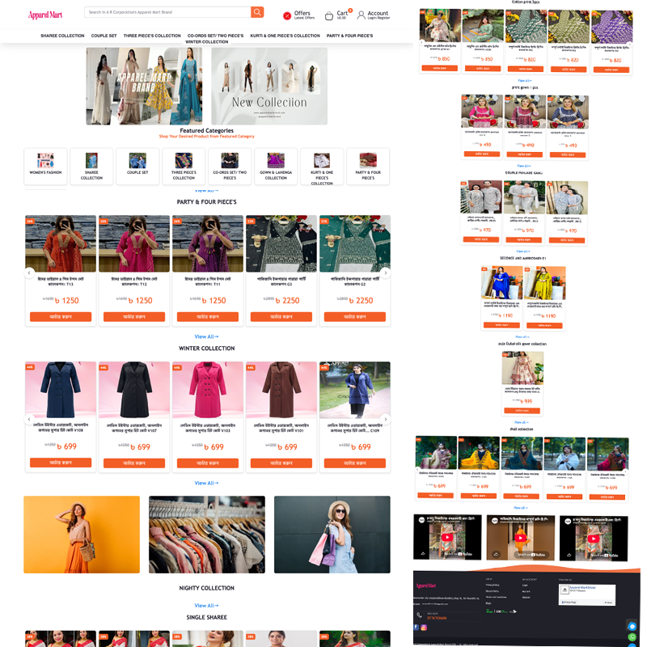

### Hi there 👋

I am Monirul Islam Prince from Bangladesh, and I do content on Design and Development. I really enjoy learning languages and frameworks like React and React Native, as well as work in WordPress. I also enjoy wireframing,

Skills: JAVA / PHP / Android / Laravel / HTML / CSS / Bootstrap / MYSQL / SQL / FIREBASE / GMAP
 

## Tech Stack :computer:

 
<table>
<tbody>
 <tr>
<td align="center" width="20%">
<b>
Ansible
</b> 
 
</td>

<td align="center" width="20%">
<b>
AWS
</b> 
 
</td>

<td align="center" width="20%">
<b>
Docker
</b> 
 
</td>
</tr>

<tr>
<td align="center" width="20%">
<b>
Flask
</b> 
 
</td>

<td align="center" width="20%">
<b>
Git
</b> 
 
</td>

<td align="center" width="20%">
<b>
Jenkins
</b> 
 
</td>
</tr>

<tr>
<td align="center" width="20%">
<b>
Kubernetes
</b> 
 
</td>

<td align="center" width="20%">
<b>
Linux System Administration
</b> 
 
</td>

<td align="center" width="20%">
<b>
Python
</b> 
 
</td>
</tr>

<tr>
<td align="center" width="20%">
<b>
MongoDB
</b> 
 
</td>

<td align="center" width="20%">
<b>
Nginx
</b> 
 
</td>

<td align="center" width="20%">
<b>
SQL
</b> 
 
</td>
</tr>

</tbody>
</table>

- 🔭 I’m currently working with Laravel, React, Next.js and Spring boot

           
 
 

  
   
 

   

<a href="https://stackoverflow.com/users/13227609/visal-rajapakse">
    
                                                        <!-- ^ Change this to your reputation -->
</a>

## Featured work

Latest kits from [reactbd.com/en/projects](https://reactbd.com/en/projects). Preview and **Source** open the paid kit; **Live** is the demo only.

<table>
  <tr>
    <td width="50%" valign="top" align="center">
      
       
      <strong>Apparel mart Store</strong> 
      Ecommerce — web, admin, and API 
      
      
    </td>
    <td width="50%" valign="top" align="center">
      
       
      <strong>Entry</strong> 
      Production full-stack ecommerce monorepo 
      
      
    </td>
  </tr>
  <tr>
    <td width="50%" valign="top" align="center">
      
       
      <strong>GoFarm Pro</strong> 
      Next.js 16 multi-vendor agricultural store 
      
      
    </td>
    <td width="50%" valign="top" align="center">
      
       
      <strong>Tulos</strong> 
      Full-stack ecommerce — Next.js 16 + Tailwind v4 
      
      
    </td>
  </tr>
 
 
</table>
### Contact

### My Work
</a>
</a>
 

